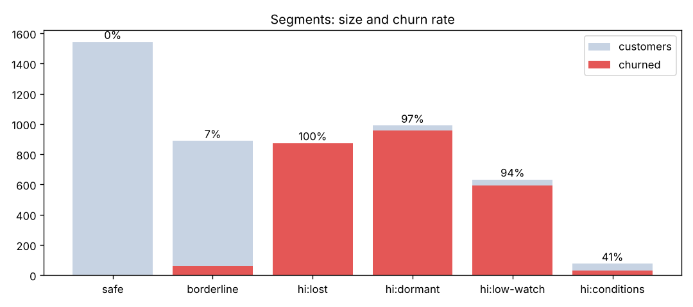

# Netflix 고객 이탈 분석

5,000명 고객 데이터(14개 변수)로 이탈 원인을 찾고, 예측 모델과 세그먼트별 대응 전략을 만든 분석.

## 핵심 결과
1. **이탈 = 참여도 하락.** 시청 5시간 미만이면 이탈 85%, 마지막 접속 30일 초과면 75%. 성별·지역·기기·장르·나이는 무관.
2. **모델·예측:** 로지스틱 AUC 0.96, 그래디언트 부스팅 AUC 0.9998(홀드아웃). 고객 5,000명 전원의 이탈 확률을 교차 예측으로 산출(GBM 정확도 98.9%, `reports/predictions.csv`). 성능이 비현실적으로 높아 라벨이 규칙으로 생성된 합성 데이터로 판단.
3. **라벨 규칙 역추정:** 7개 조건의 점수합(시청<5h +2, 미접속>30일 +2, Basic +1, Crypto/Gift +1, 프로필≤3 +1, 접속<7일 −1, 시청>20h −2)이 **3점 이상이면 이탈** → 라벨 96.5% 재현.
4. **전략:** 이탈자의 97%가 '휴면형'과 '저시청형'. 1순위는 미접속 30일 전 재방문 유도(휴면형 989명 중 91% 규칙상 구제), 2순위는 시청 5시간 돌파 유도(저시청형 94%).



## 보고서
| 단계 | 문서 | 코드 |
|---|---|---|
| EDA | [01_eda.md](reports/01_eda.md) | `src/eda.py` |
| 기획 | [02_plan.md](reports/02_plan.md) | |
| 모델링·예측·규칙 역추정 | [03_model.md](reports/03_model.md) | `src/model.py`, `src/predict.py`, `src/risk_score.py` |
| 세그먼트·전략 | [04_segments.md](reports/04_segments.md) | `src/segment.py` |

## 재현
```bash
pip install -r requirements.txt
python3 src/eda.py && python3 src/model.py && python3 src/risk_score.py && python3 src/segment.py && python3 src/predict.py
```

## 한계
합성 데이터, 시점 정보 없음(인과 판단 불가), what-if는 역추정 규칙 기준 계산이며 실제 효과는 A/B 테스트 필요.
